# WM-Craftnet: World Synesthesia Model for Generalizable and Robust Dexterous In-Hand Manipulation

<p align="center">
  <a href="https://scholar.google.com/citations?user=Y8LVRYIAAAAJ&hl=en"><strong>Jie Yin</strong></a> ·
  <a href="https://openreview.net/profile?id=~Zeyuan_Zhao3"><strong>Zeyuan Zhao</strong></a> ·
  <a href="https://openreview.net/profile?id=~Xiaojing_Tan1"><strong>Xiaojing Tan</strong></a> ·
  <a href="https://openreview.net/profile?id=~Yang_Liu268"><strong>Yang Liu</strong></a> ·
  <a href="https://openreview.net/profile?id=~Chiyu_Wang3"><strong>Chiyu Wang</strong></a> ·
  <a href="https://openreview.net/profile?id=~Xinyang_Gu1"><strong>Xinyang Gu</strong></a>
</p>

<p align="center">
  🏆 <strong>CoRL 2026 Spotlight</strong> (Top 4.4%)
</p>

<p align="center">
  <a href="https://www.sharpa.com/">
    
  </a>
</p>


[](https://wmcraftnet.github.io)
[](https://arxiv.org/abs/2609.07002)
[](https://huggingface.co/SharpaIT/WM-Craftnet)
[](https://www.corl.org/)
[](LICENSE)
[](https://www.sharpa.com/pages/wave)
[](https://developer.nvidia.com/isaac-gym)


<p align="center">
  <a href="https://wmcraftnet.github.io">
    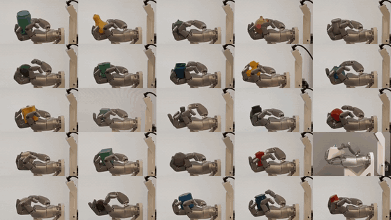
  </a>
</p>

## 1. Overview

WM-Craftnet learns a **World Synesthesia Model (WSM)** for dexterous in-hand rotation. It fuses proprioception, noisy wrist depth, tactile contact, and action history into an action-conditioned recurrent state that captures geometry, contact, motion, and slip. That state is passed directly to an asymmetric actor–critic policy as a deployable representation—without imagined rollouts.

The model also reconstructs clean depth from noisy observations, which improves sim-to-real transfer to the human-sized, five-finger, 22-DoF [Sharpa Wave](https://www.sharpa.com/pages/wave) hand.

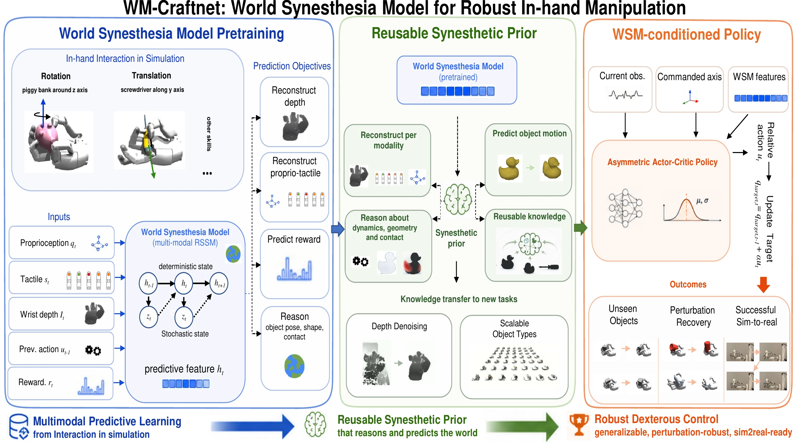

## 2. Highlights

| | |
| --- | --- |
| **Predictive visuotactile state** | Fuses proprioception, depth, touch, and action history while denoising hand–object geometry. |
| **Robust, generalizable control** | Handles multiple objects, unseen geometries, pose shifts, drift, and external disturbances. |
| **Reusable physical prior** | A WSM pretrained on nine z-axis objects can initialize learning on other object sets. |
| **Real-robot deployment** | Transfers to Sharpa Wave using deployable wrist depth and tactile sensors. |

## 3. Method

1. **Encode** proprioception, wrist depth, tactile contact, and the previous action.
2. **Predict** action-conditioned dynamics with a Dreamer-style recurrent state-space model, supervised by clean depth and reward.
3. **Control** with the detached deterministic WSM state fed to the policy; reuse pretrained WSM weights for new object sets.

## 4. Demos

<table>
  <tr>
    <td valign="top" width="33%">
      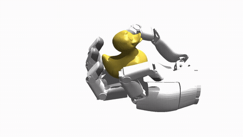
      <br/>
      <b>Duck</b> · z-axis
      <br/>
      Stable finger contacts on a curved, asymmetric object during continuous z-axis rotation.
    </td>
    <td valign="top" width="33%">
      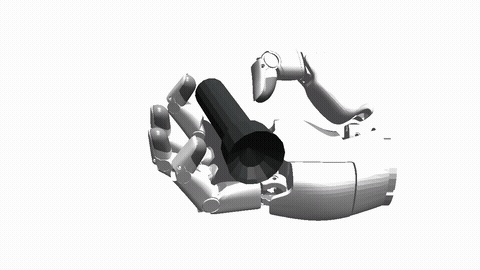
      <br/>
      <b>Flashlight</b> · y-axis
      <br/>
      Target-axis rotation of an elongated body about its shorter axis under larger moment arms.
    </td>
    <td valign="top" width="33%">
      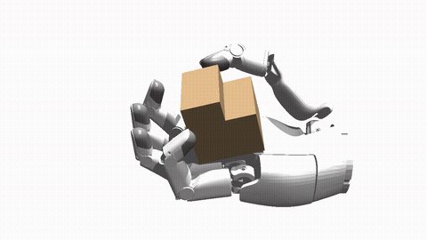
      <br/>
      <b>Stepped block</b> · x-axis
      <br/>
      Rolling and fingertip-contact reallocation for gravity-sensitive x-axis rotation.
    </td>
  </tr>
  <tr>
    <td valign="top" width="33%">
      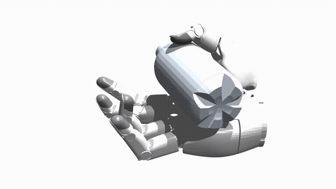
      <br/>
      <b>Bottle</b> · thumb-guided re-centering
      <br/>
      0–10 s: thumb draws the bottle toward the fingers, then y-axis rotation continues.
    </td>
    <td valign="top" width="33%">
      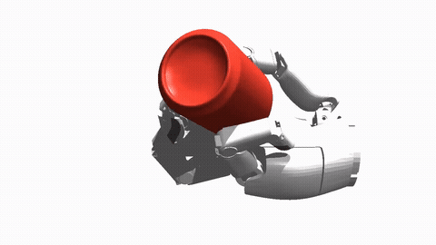
      <br/>
      <b>Coke Can</b> · five-finger stabilization
      <br/>
      0–5 s: all five fingers upright the can from a poor start, then z-axis rotation resumes.
    </td>
    <td valign="top" width="33%">
      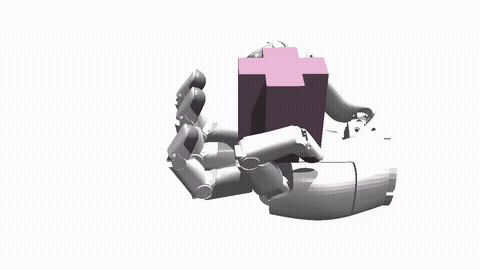
      <br/>
      <b>Cross block</b> · palm-to-finger transfer
      <br/>
      0–7 s: fingers move the object from the palm onto the fingertips, then z-axis rotation continues.
    </td>
  </tr>
</table>

More real-robot, multi-axis, depth-reconstruction, and unseen-object rollouts are on the [project website](https://wmcraftnet.github.io).

---

## 5. Quick Start

### 5.1 Requirements

- Linux with an NVIDIA GPU and a compatible CUDA driver
- Python 3.8
- PyTorch 2.1.0 with CUDA 11.8
- NVIDIA Isaac Gym Preview 4

### 5.2 Install the environment

```bash
conda create -n wm-craftnet python=3.8
conda activate wm-craftnet

conda install pytorch=2.1.0 torchvision torchaudio pytorch-cuda=11.8 \
  -c pytorch -c nvidia
conda install -c fvcore -c iopath -c conda-forge fvcore iopath
conda install pytorch3d -c pytorch3d

pip install hydra-core gym numpy==1.22.2 tensorboardX tensorboard \
  wandb scipy imageio imageio-ffmpeg h5py trimesh rtree pillow ninja
```

Download [NVIDIA Isaac Gym Preview 4](https://developer.nvidia.com/isaac-gym), accept its license, then install:

```bash
tar -xzvf IsaacGym_Preview_4_Package.tar.gz
cd isaacgym/python
pip install -e . --no-deps
```

See [`install.md`](install.md) for additional notes.

### 5.3 Run a simulation test

Download the released z-axis checkpoint and run the test script:

```bash
hf download SharpaIT/WM-Craftnet wm_craftnet_set_z.pth --local-dir example_ckpt

CHECKPOINT=example_ckpt/wm_craftnet_set_z.pth \
bash scripts/test_wm_craftnet.sh
```

- Weights: [`wm_craftnet_set_z.pth`](https://huggingface.co/SharpaIT/WM-Craftnet/blob/main/wm_craftnet_set_z.pth) on [`SharpaIT/WM-Craftnet`](https://huggingface.co/SharpaIT/WM-Craftnet)
- Config: [`example_ckpt/wm_craftnet_set_z.yaml`](example_ckpt/wm_craftnet_set_z.yaml)

The script opens the viewer by default. Pass extra Hydra arguments after the script name, or set `HEADLESS=true` when no display is available.

---

## 6. Training

### 6.1 Start a training run

Each entry script selects the matching task config and accepts Hydra overrides:

```bash
# z-axis rotation on nine objects
bash scripts/train_wm_craftnet_z.sh task.env.objSet=set_z

# x-axis rotation on four objects
bash scripts/train_wm_craftnet_x.sh task.env.objSet=set_x4

# y-axis rotation on nine tool-like objects
bash scripts/train_wm_craftnet_y.sh task.env.objSet=set_y
```

### 6.2 Choose an object set

| Set | Objects | Task |
| --- | --- | --- |
| `set_z` | 9 diverse shapes | z-axis rotation; WSM pretraining |
| `set_x4` | 4 contact-constrained shapes | x-axis rotation |
| `set_y` | 9 elongated / tool-like shapes | y-axis rotation |

Object meshes, robot assets, and datasets may have terms outside this repository. See [`THIRD_PARTY_NOTICES.md`](THIRD_PARTY_NOTICES.md) before redistribution.

### 6.3 Configure memory and devices

The paper setup uses `num_envs=1024` and `minibatch_size=4096` ([`WMCraftnetPPO.yaml`](isaacgymenvs/cfg/train/WMCraftnetPPO.yaml)). Scripts default to `256` envs and a `1024` minibatch so the WSM replay buffer fits on a 32 GiB host:

```bash
# default (memory-safe)
bash scripts/train_wm_craftnet_y.sh

# lower further if needed
NUM_ENVS=128 MINIBATCH_SIZE=512 bash scripts/train_wm_craftnet_y.sh

# paper settings on larger machines
NUM_ENVS=1024 MINIBATCH_SIZE=4096 bash scripts/train_wm_craftnet_y.sh
```

Edit the device switches at the top of each script for simulation, RL, and graphics GPUs. Outputs go to `runs/`.

### 6.4 Configure WSM prediction heads

Six optional heads are enabled by default—proprioception, clean depth, object pose, tactile contact, critic value, and BPS object shape—plus reward prediction. Configure them under `task.env.cameraPolicy.worldModel` in [`WMCraftnetRotation.yaml`](isaacgymenvs/cfg/task/WMCraftnetRotation.yaml):

```bash
# legacy setup: proprioception + depth only (matches released checkpoint)
bash scripts/train_wm_craftnet_z.sh \
  task.env.cameraPolicy.worldModel.wm_pose_pred=False \
  task.env.cameraPolicy.worldModel.wm_tac_pred=False \
  task.env.cameraPolicy.worldModel.wm_value_pred=False \
  task.env.cameraPolicy.worldModel.wm_obj_pred=False
```

Checkpoint and head configs must match at train and test time. The released checkpoint uses proprioception + depth; evaluate with `scripts/test_wm_craftnet.sh`. Full-head runs need matching flags (see `scripts/test_wm_craftnet_y.sh`).

---

## 7. Real-Robot Deployment

The released deployment targets a Sharpa Wave hand with an Intel RealSense D405 wrist camera. Runtime examples are under [`deploy/`](deploy/), and the camera-mount CAD models are under [`assets/cad/wrist_camera_mount/`](assets/cad/wrist_camera_mount/). Use **Python 3.10** for deployment; simulation and training stay on **Python 3.8**.

<table>
  <tr>
    <td align="center" valign="top" width="33%">
      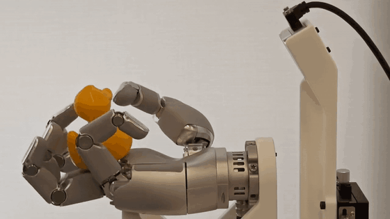
      <br/>
      <b>Real Z-Axis Duck Rotation</b>
      <br/>
      WM-Craftnet rotates a duck on the Sharpa Wave hand using wrist depth and tactile feedback.
    </td>
    <td align="center" valign="top" width="33%">
      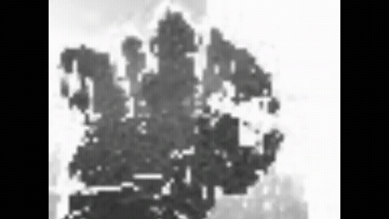
      <br/>
      <b>Real Noisy Wrist Depth</b>
      <br/>
      Raw depth from the wrist camera during the same rollout—noisy, incomplete, and hard to use directly for control.
    </td>
    <td align="center" valign="top" width="33%">
      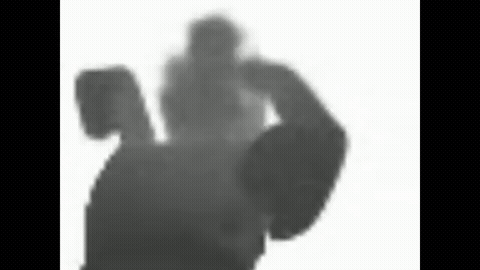
      <br/>
      <b>Real Predicted Depth from WSM Latent</b>
      <br/>
      WSM reconstructs a cleaner depth map that preserves hand–object geometry despite sensor noise.
    </td>
  </tr>
</table>

On real hardware, the wrist depth stream is noisy and incomplete. The WSM latent reconstructs a cleaner depth representation that preserves hand–object geometry—supporting the same policy at deployment time. More rollouts are on the [project website](https://wmcraftnet.github.io/#depth-reconstruction).

### 7.1 Prepare the hardware and choose a camera mount

The current mounting hardware uses an **Intel RealSense D405**. The **Intel RealSense L515** reported in the paper belongs to an earlier hardware revision and is not the camera modeled by the STEP files below.

#### D405 wrist-camera mounts

Two mount variants are provided for the alternative camera-to-hand-bracket interfaces:

| Hand-bracket interface | STEP model |
| --- | --- |
| Six-bolt circular pattern | [`sharpa_wave_wrist_camera_mount_6_bolt.step`](assets/cad/wrist_camera_mount/sharpa_wave_wrist_camera_mount_6_bolt.step) |
| Four-bolt square pattern | [`sharpa_wave_wrist_camera_mount_4_bolt.step`](assets/cad/wrist_camera_mount/sharpa_wave_wrist_camera_mount_4_bolt.step) |

Choose the model that matches your hand bracket. Before manufacturing or assembly, verify all interface dimensions, fastener clearances, camera field of view, and collision-free hand motion against your hardware revision.

### 7.2 Install the Sharpa Wave SDK

Download from the [Sharpa download page](https://www.sharpa.com/pages/downloads) or [GitHub releases](https://github.com/sharpa-robotics/sharpa-wave-sdk/releases). On x86-64 Ubuntu, run from the repository root to install the public non-CUDA SDK v5.0.9 under `deploy/sharpa_sdk/`:

```bash
SDK_DEB=/tmp/sharpa-wave-sdk_5.0.9_amd64.deb
SDK_TMP=$(mktemp -d)

curl -fL \
  https://github.com/sharpa-robotics/sharpa-wave-sdk/releases/download/v5.0.9/sharpa-wave-sdk_5.0.9_amd64.deb \
  -o "$SDK_DEB"
echo "672c0b2e02f64c0db22760e8331f6e35e1fc9e7ef84363e81481e608a1278dfb  $SDK_DEB" \
  | sha256sum -c -
dpkg-deb -x "$SDK_DEB" "$SDK_TMP"

rm -rf deploy/sharpa_sdk/lib deploy/sharpa_sdk/python/sharpa
mkdir -p deploy/sharpa_sdk/python
cp -a "$SDK_TMP/opt/sharpa-wave-sdk/lib" deploy/sharpa_sdk/lib
cp -a "$SDK_TMP/opt/sharpa-wave-sdk/python/sharpa" deploy/sharpa_sdk/python/sharpa
cp "$SDK_TMP/opt/sharpa-wave-sdk/VERSION" deploy/sharpa_sdk/VERSION
cp "$SDK_TMP/opt/sharpa-wave-sdk/sdk-release-info.json" deploy/sharpa_sdk/sdk-release-info.json

rm -rf "$SDK_TMP" "$SDK_DEB"
```

The non-CUDA build receives 30 Hz tactile inference from the hand. The optional CUDA SDK build requires CUDA 13.x and TensorRT 10.x.

### 7.3 Configure the checkpoint and inference runtime

Download [`wm_craftnet_set_z.pth`](https://huggingface.co/SharpaIT/WM-Craftnet/blob/main/wm_craftnet_set_z.pth) into `example_ckpt/` beside [`wm_craftnet_set_z.yaml`](example_ckpt/wm_craftnet_set_z.yaml). In `build_hardcoded_config()` inside [`wm_craftnet_infer.py`](deploy/examples/wm_craftnet_infer.py), set the checkpoint path and camera options. Set `no_actuation=True` and a finite `max_steps`, and keep actuation disabled until the calibration and dry-run checks below are complete.

### 7.4 Calibrate the sim-to-real setup

The policy depends on the complete observation and control stack—not just the checkpoint. Match the real setup to training, then tune the simulation and domain-randomization ranges from measurements of the actual hardware.

| What to calibrate | Configuration |
| --- | --- |
| Camera extrinsics (`pos`, `rot`) | [`WMCraftnetRotation.yaml`](isaacgymenvs/cfg/task/WMCraftnetRotation.yaml) → `task.env.cameraPolicy.sensor` |
| Camera resolution and intrinsics (`width`, `height`, `fov`) | same `sensor` block |
| Depth crop and observation DR | same file → `task.env.cameraPolicy.depth_preprocess.{crop,noise}` |
| Hand dynamics and dynamics DR | same file → `frictionRandomization`, `pdRandomization`, and `randomization_params` |
| RealSense stream (`cam_width`, `cam_height`, `cam_fps`) | [`wm_craftnet_infer.py`](deploy/examples/wm_craftnet_infer.py) → `build_hardcoded_config()` |
| Control period | Checkpoint YAML → `sim.dt` and `task.env.controlFrequencyInv`; runtime derives `control_hz` from both |
| Checkpoint and dry-run switches | `build_hardcoded_config()` → `checkpoint`, `no_actuation`, and `max_steps` |

> [!CAUTION]
> A learned policy can command sudden, unexpected motion. Before sending any command, confirm the robot identity and network connection, test the emergency stop, enforce joint and torque limits, clear people and obstacles from the workspace, and begin at reduced speed under direct supervision.

### 7.5 Validate before enabling actuation

1. Mount the D405 and measure its pose relative to the hand; update the simulated camera extrinsics accordingly.
2. Configure the RealSense stream. Runtime resizes depth to `96 × 72` before applying `depth_preprocess.crop`.
3. Measure the real hand response, contact behavior, and depth artifacts; tune dynamics and depth-observation DR to cover the observed conditions.
4. Compare real and simulated depth. Correct camera pose first, then crop and noise settings—do not change the policy input size.
5. With `no_actuation=True`, start a finite dry run:

   ```bash
   conda activate inhand_deploy310
   python deploy/examples/wm_craftnet_infer.py
   ```

   Inspect the depth preview, telemetry, inference latency, and control-loop overruns.
6. Verify the emergency stop and motion limits, then enable actuation at reduced speed before increasing performance.

> [!TIP]
> **Control-rate tuning.** After validating end-to-end latency and hardware safety, training and deploying with a matched **20 Hz or 30 Hz** control loop can provide smoother motion than the released 10 Hz timing. Keep the checkpoint timing and real control loop synchronized.

### 7.6 Optional: run inference on an Intel GPU (XPU)

The deployment inference (WSM and policy) also runs on Intel GPUs, such as the Arc Pro B60, through PyTorch's XPU backend. In the deployment environment, install the XPU build of PyTorch instead of the CUDA build, then the packages the deploy scripts import:

```bash
pip install torch --index-url https://download.pytorch.org/whl/xpu
pip install gym numpy omegaconf hydra-core pyyaml pyrealsense2 pyzmq
python deploy/examples/wm_craftnet_infer.py
```

`build_hardcoded_config()` picks the device by itself: CUDA first, then XPU, then the CPU. Set `device` there (for example `"xpu:0"`) to choose one. Simulation, training and evaluation use Isaac Gym, which needs an NVIDIA GPU, so they stay CUDA-only.

---

## 8. Related Work

For our latest work on dexterous reorientation, see [**TacBPM: A Tactile-conditioned Behavior Prior Model for Dexterous Reorientation**](https://arxiv.org/abs/2609.18174). Its code and associated resources will be open-sourced in a future release.

## 9. Acknowledgements

WM-Craftnet builds on:

- [Isaac Gym Environments (IsaacGymEnvs)](https://github.com/isaac-sim/IsaacGymEnvs) — simulation and RL infrastructure
- [World Model-based Perception (WMP)](https://github.com/bytedance/WMP) — world-model-conditioned policy learning
- [Robot Synesthesia / in-hand rotation](https://github.com/YingYuan0414/in-hand-rotation) — dexterous manipulation task design
- [DreamerV3](https://github.com/danijar/dreamerv3) — recurrent state-space world model
- [rl_games](https://github.com/Denys88/rl_games) — PPO training backend

See [`NOTICE`](NOTICE) and [`THIRD_PARTY_NOTICES.md`](THIRD_PARTY_NOTICES.md) for license texts and attribution.

## 10. Citation

```bibtex
@inproceedings{yin2026wmcraftnet,
  title     = {WM-Craftnet: World Synesthesia Model for Generalizable and Robust Dexterous In-Hand Manipulation},
  author    = {Yin, Jie and Zhao, Zeyuan and Tan, Xiaojing and Liu, Yang and Wang, Chiyu and Gu, Xinyang},
  booktitle = {Conference on Robot Learning (CoRL)},
  year      = {2026}
}
```

## 11. License

Released under the [Apache License, Version 2.0](LICENSE). See [`NOTICE`](NOTICE) and [`THIRD_PARTY_NOTICES.md`](THIRD_PARTY_NOTICES.md) for third-party attribution.
